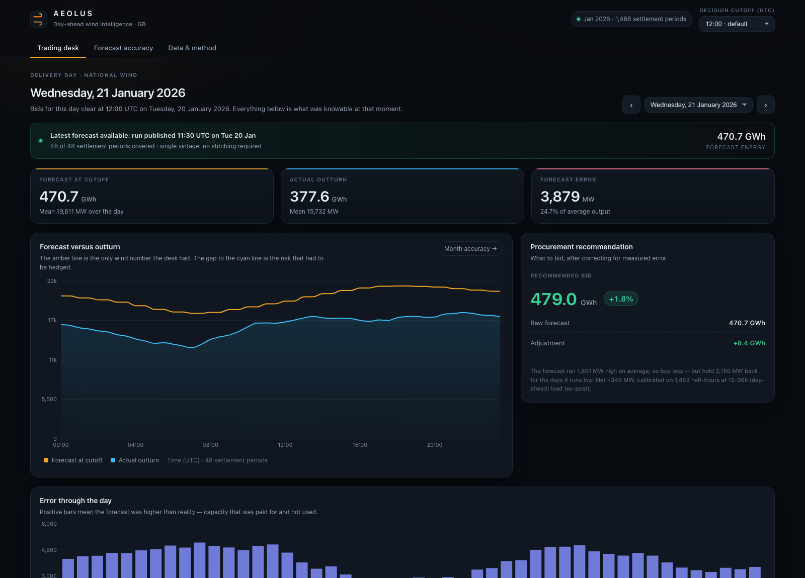

# Aeolus — day-ahead wind intelligence

A pilot web application for a GB energy utility's day-ahead trading desk. It answers two
questions the desk actually asks before gate closure:

1. **What is the latest wind forecast I could have seen, and what does it imply for my volume?**
2. **How wrong is that forecast, quantitatively — and how much headroom should I hold because of it?**

Built from exactly two public Elexon BMRS streams (`FUELHH` actuals, `WINDFOR` forecasts), January 2026
delivery, national wind, per the brief.



---

## The headline finding (January 2026)

The wind forecast is not merely noisy — it is **biased high**, and that bias is the single largest
component of the error.

| Metric | Value |
| --- | --- |
| Mean absolute error (day-ahead, 12–36h lead) | **2,021 MW** (17.5% of mean outturn) |
| Mean error / bias | **+1,806 MW** — the forecast runs 15.6% above outturn |
| Half-hours where the forecast was too high | **85.4%** (1,271 of 1,488) |
| MAE after simply subtracting the mean error | **1,338 MW** — a 33.8% reduction |
| Implied over-procurement across the month | **1,344 GWh** |
| Recommended net bid adjustment | **+349 MW** (+2.6% of forecast) |

> The bias (+1,806 MW) nearly cancels the headroom the desk needs for the tails (+2,150 MW). The net
> effect is small, but it is *not* zero, and it is knowable in advance. That is the product.

Best day: 19 Jan (552 MW MAE). Worst: 11 Jan (4,945 MW MAE).

The app shows both the raw and the de-biased series, because "your forecast is wrong" is not actionable
but "your forecast is wrong in a predictable direction by a measurable amount" is.

---

## Quick start

### Docker (recommended — this is exactly what deploys)

```bash
docker compose up --build
# open http://localhost:8000
```

The image is multi-stage: Node builds the React bundle, then a slim Python runtime serves both the API
and the static bundle from one process, one port, one origin (no CORS, no second deploy target).

### Local development

```bash
# 1. Backend (Python 3.11+)
python3 -m venv .venv && source .venv/bin/activate
pip install -r backend/requirements.txt -r backend/requirements-dev.txt
cd backend && uvicorn app.main:app --reload --port 8010

# 2. Frontend (Node 20+)
cd frontend && pnpm install && pnpm dev      # http://localhost:5173, proxies /api to :8010
```

### Rebuilding the data (optional — the warehouse is committed)

```bash
cd backend
python -m app.ingest          # ~90s, 70 requests, incremental
python -m app.ingest --force  # re-download everything
pytest -q                     # 18 tests
```

---

## Deployment

The repository is deploy-ready for **Heroku** (container stack). A single web dyno serves the whole app.

```bash
heroku create <your-app-name>
heroku stack:set container -a <your-app-name>
git push heroku main
heroku open
```

`heroku.yml` supplies the build target; the container's `CMD` honours the injected `$PORT`.

**Deployed URL:** _to be filled in after deploy — e.g._ `https://<your-app-name>.herokuapp.com`

For a split deployment (static frontend elsewhere), set `VITE_API_BASE_URL` at build time to the API
origin; the frontend falls back to same-origin `/api` paths when it is unset.

---

## Repository layout

```
.
├── Dockerfile                  # multi-stage: node build -> python runtime, single origin
├── docker-compose.yml          # one service, port 8000
├── heroku.yml                  # container-stack deploy manifest
├── backend/
│   ├── app/
│   │   ├── config.py           # scope: dates, datasets, default cutoff, paths
│   │   ├── elexon.py           # HTTP client, retries, client-side validation of filters
│   │   ├── ingest.py           # CLI: Elexon -> SQLite warehouse (idempotent upserts)
│   │   ├── db.py               # schema + the handful of queries we need
│   │   ├── analytics.py        # THE CORE: vintage selection, metrics, headroom
│   │   ├── util.py             # UTC time helpers, half-hour grid
│   │   └── main.py             # FastAPI routes, caching, static mount
│   ├── data/wind.db            # committed warehouse (1,488 actuals, 21,608 forecast rows)
│   ├── tests/                  # 18 unit + API tests, no network required
│   └── requirements*.txt
├── frontend/
│   └── src/
│       ├── App.tsx             # shell, tabs, global cutoff + deep-link state
│       ├── pages/              # DecisionPage, AccuracyPage, MethodPage
│       ├── components/         # charts (Recharts), KPI/panel primitives, logo
│       ├── api.ts              # typed fetch wrapper + cancellation hook
│       ├── types.ts            # response contracts, hand-written
│       └── styles.css          # design system
└── docs/
    ├── VIDEO_SCRIPT.md         # timed script for both parts of the demo video
    └── screenshots/
```

---

## How the analysis works

### 1. Reconstructing what the desk knew

`WINDFOR` is a *vintaged* dataset: the same delivery hour appears once per forecast run — 8 runs a day,
at 02:30, 04:30, 07:30, 09:30, 11:30, 15:30, 18:30 and 22:30 UTC. Every run carries exactly **73 hourly
points over a fixed 72-hour delivery window**, from 21:00 the day before the run to 21:00 two days after
it (verified across all 296 vintage runs). The split between past and future therefore shifts with
publication time: the 02:30 run reaches 66.5h ahead, the 22:30 run only 46.5h. A later run is *fresher*,
not longer.

For delivery half-hour `t` on day `D` with gate closure `c = D−1 12:00Z`:

```
forecast(t) = the newest vintage v where
              v.startTime = floor_to_hour(t)  and  v.publishTime <= c
```

`ForecastIndex` keeps every vintage per delivery hour sorted by publish time and bisects, so this is
O(log n) and — more importantly — **provably free of look-ahead**. A run published at 12:25 on the
delivery day exists in the data and is never used for a 12:00 cutoff. Changing the cutoff in the UI
changes which vintages qualify, and the metrics move accordingly.

### 2. Bridging the two resolutions

The streams do not share a clock. `FUELHH` returns **48 half-hourly** values per day; `WINDFOR` returns
**24 hourly** values per delivery day. That fixed 72-hour window is also why a 12:00 cutoff on D−1 — the
11:30 run — always covers all 48 periods of D: its window is (D−2) 21:00 → (D+1) 21:00. Full coverage is
structural, not luck.

The delivery grid is the settlement period, because that is the unit the desk bids and settles. So:

- Each half-hour resolves to the forecast for the hour containing it — `floor_to_hour(t)` — and that
  hourly value is **held flat across the two periods it covers**. Nothing is interpolated: inventing
  intra-hour shape would claim precision the forecast does not have.
- Each settlement period is then scored against **its own** outturn, so the metric measures the imbalance
  the desk actually carries in each period rather than an hour-averaged abstraction.
- Energy aggregation stays consistent: `MW × 0.5 h` per period, so a day of flat pairs sums to the same
  MWh as summing the hourly values. Sample sizes are counted in periods (1,488), not hours (744).

The alternative convention — collapsing outturn to the hourly grid by averaging each pair — gives
**MAE 2,018 MW vs 2,021 MW (+0.13%)**, RMSE 2,477 vs 2,481, identical bias. The choice changes no
conclusion; it is documented here so a reviewer can see it was considered rather than stumbled into.

### 2. Metrics

| Metric | Definition | Why |
| --- | --- | --- |
| MAE | mean \|forecast − actual\| | headline miss in MW |
| RMSE | √mean(error²) | punishes the big misses |
| Bias | mean(forecast − actual) | direction and size of the systematic miss |
| nMAE | MAE ÷ mean outturn | **not** MAPE, which explodes when wind is near zero |
| De-biased MAE | MAE of the centred error | separates systematic from random error |
| Headroom (p90) | 90th percentile of the centred shortfall | the number of MW to hold for 9-in-10 coverage |

### 3. From error to a bid

The recommendation on the trading desk view is two corrections composed:

```
bid = forecast − bias + headroom(p90)
```

with `bias` and `headroom` calibrated on realised January 2026 error **over the same lead-time window
the cutoff implies** (12–36h for a 12:00 cutoff; move the cutoff to 18:00 and the window becomes 6–30h).

This is deliberately an empirical quantile — no distributional assumption — and deliberately *ex post*.
It is labelled as such in the UI: production would need a rolling walk-forward window so a past bid is
never informed by a future outcome.

---

## API

| Route | Purpose |
| --- | --- |
| `GET /api/decision?delivery_date=&cutoff_hour=` | vintage-aware reconstruction for one day + procurement adjustment |
| `GET /api/accuracy?start=&end=&cutoff_hour=` | metrics, lead-time curve, histogram, daily ranking |
| `GET /api/vintages?delivery_date=&cutoff_hour=` | every run covering a day, flagged usable / not |
| `GET /api/meta` | coverage, provenance, assumptions; drives the date pickers |
| `GET /api/health` | liveness probe |
| `GET /docs` | generated OpenAPI schema |

All analytical responses are pure functions of `(date range, cutoff hour)` and cached in-process.

---

## Assumptions and limitations

- **Units.** `WINDFOR` values are treated as MW. Elexon does not state units upstream; magnitudes are
  consistent with national wind output.
- **Structural bias.** The forecast runs consistently above transmission-metered wind outturn — measured
  at 85.4% of half-hours, not assumed. Treated as a calibration problem rather than a defect in either
  feed, since the two streams may not share a boundary definition.
- **Ex-post calibration.** Headroom is estimated on realised January error (see above).
- **Scope.** Wind generation only, national level, as the brief specifies. There is no demand model, so
  the output is a wind-volume adjustment, not a full energy position.
- **No DST handling needed.** January is GMT throughout, so 48 settlement periods hold. The half-hour
  generator is not hardcoded to 48 elsewhere.
- **Actuals are revised** by Elexon; the ingest upserts on `(start_time, fuel_type)` so re-running picks
  up revisions rather than duplicating them.

---

## Using AI tools

This project was built with AI assistance (agentic coding assistant). Specifics, for transparency:

- The AI drafted the backend, frontend, tests, Dockerfile and documentation from the brief.
- **All analytical claims were verified against the live Elexon API**, not taken on trust: the vintage
  counts, the publish cadence, the exclusive `publishDateTimeTo` bound, and the bias figure were each
  checked against raw responses (see the commit history / scratch verification steps).
- One test failed during development (`test_latest_vintage_is_the_newest_one_before_the_cutoff`); the
  cause was a wrong fixture in the test itself, not the implementation, and the test was corrected
  rather than the code.
- Design decisions, the framing of the bias finding, and the scope trade-offs were reviewed and are
  documented above rather than left implicit.

---

## Video walkthrough

See [`docs/VIDEO_SCRIPT.md`](docs/VIDEO_SCRIPT.md) for the timed script covering both parts
(customer pitch and technical review).
